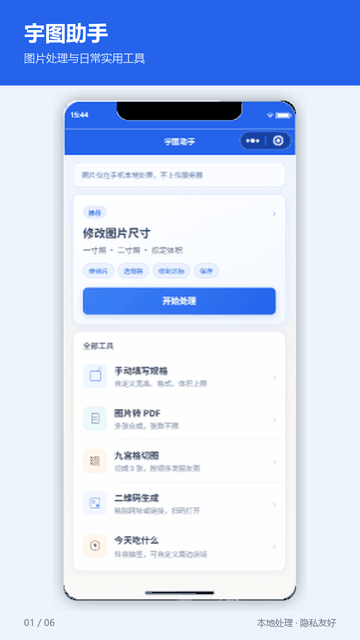
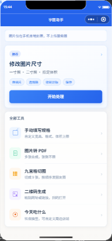
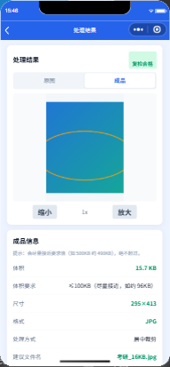
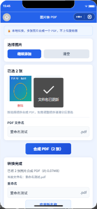

# 宇图助手

宇图助手是一款原生微信小程序，提供报名照合规处理、图片转 PDF、九宫格切图、二维码生成和“今天吃什么”随机转盘。所有图片均在用户设备本地处理，无后端服务器，不上传、不存储、不公开展示任何用户内容。

## 功能

| 工具 | 主要能力 |
|---|---|
| 报名照处理 | 检测格式、体积、尺寸和比例；裁剪、缩放、格式转换及压缩 |
| 自定义规格 | 自定义宽高、JPG/PNG 格式和体积上限 |
| 图片转 PDF | 最多选择 30 张图片，合成、预览、重命名和分享 PDF |
| 九宫格切图 | 将方形预览区域切成 3×3 图片并批量保存 |
| 二维码生成 | 将 HTTP/HTTPS 链接生成二维码并保存到相册 |
| 今天吃什么 | 内置餐饮转盘，支持新建、编辑、删除和切换选项 |
| 微信分享 | 所有页面支持右上角转发，接收者统一进入稳定的首页入口 |

## 开箱 Demo

点击下方动图可打开 MP4 视频：

[](./docs/demo/demo.mp4)

> 视频依次演示首页、报名照处理结果、图片转 PDF、九宫格切图、二维码生成和随机转盘。若当前 Markdown 查看器不支持直接播放，请下载 [demo.mp4](./docs/demo/demo.mp4)。

### 1. 启动项目

准备微信开发者工具和一个有开发权限的小程序 AppID，然后：

1. 打开微信开发者工具，选择“导入项目”，目录选择仓库根目录 `yutu_assistant/`（`project.config.json` 已配置 `miniprogramRoot: miniprogram/`）。
2. 检查 `project.config.json` 中的 `appid` 是否属于当前登录账号。
3. 点击“编译”，模拟器应显示宇图助手首页。无需开通云开发或配置服务器域名。



### 2. 演示报名照处理

```text
首页“开始处理”
  -> 从相册选择照片
  -> 选择一寸照、二寸照或指定体积
  -> 查看格式、体积、尺寸和比例检测
  -> 选择整图缩放或居中裁剪
  -> 自动处理并复检
  -> 保存到相册
```

处理完成后会显示成品尺寸、格式、体积、处理方式和复检结果：



### 3. 演示图片转 PDF

```text
首页“图片转 PDF”
  -> 从相册选择 1 至 30 张图片
  -> 调整文件名称
  -> 点击“合成 PDF”
  -> 预览或分享文件
```



### 4. 演示其他工具

- 九宫格：选择方图或横竖图，居中取正方形并切成 9 张图片。
- 二维码：输入 HTTP/HTTPS 链接，生成后用另一台手机扫码验证。
- 随机转盘：点击开始转动，也可进入管理页维护转盘内容。
- 页面分享：点击右上角 `...`，选择“转发”；好友打开后进入宇图助手首页。

## 内置照片规格

| 场景 | 尺寸 | 格式 | 默认上限 |
|---|---:|---|---:|
| 四六级 | 144×192 | JPG | 200KB |
| 考研报名 | 295×413 | JPG | 100KB |
| 教师资格证 | 295×413 | JPG | 200KB |
| 计算机等级考试 | 390×567 | JPG | 200KB |
| 一寸照 | 295×413 | JPG | 200KB |
| 二寸照 | 413×579 | JPG | 500KB |
| 自定义 | 用户填写 | JPG/PNG | 用户填写 |

> 各考试官网的照片要求可能调整，上线前应核对当年官方规格，并同步更新 `miniprogram/utils/scenes.js`。

## 技术架构

- 微信小程序原生技术栈：WXML、WXSS、JavaScript。
- Canvas 2D：裁剪、缩放、压缩、二维码、九宫格及 PDF 图片转换。
- 微信文件系统：临时图片和 PDF 文件处理。
- 本地 Storage：保存额度及转盘数据。
- 无业务后端、无云开发、无网络请求，照片不上传到任何服务器。

核心流程：

```text
Page 页面层
  -> utils 场景、检测和处理逻辑
  -> Canvas / 微信文件系统 / 本地 Storage
  -> 结果复检与交付
```

## 目录结构

```text
yutu_assistant/
├── README.md
├── project.config.json          # miniprogramRoot: miniprogram/
├── miniprogram/                 # 小程序源码
│   ├── app.js / app.json / app.wxss / sitemap.json
│   ├── components/
│   │   └── ad-banner/           # Banner 广告组件
│   ├── config/
│   │   └── ad-config.js         # 广告位配置
│   ├── libs/
│   │   └── qrcode-generator.js
│   ├── pages/
│   │   ├── index/               # 首页
│   │   ├── workspace/           # 照片检测与处理
│   │   ├── result/              # 结果复检与保存
│   │   ├── custom/              # 自定义规格
│   │   ├── img2pdf/             # 图片转 PDF
│   │   ├── grid-cut/            # 九宫格切图
│   │   ├── qrcode/              # 二维码生成
│   │   ├── eat/                 # 随机转盘
│   │   ├── eat-manage/          # 转盘管理
│   │   └── eat-edit/            # 转盘编辑
│   ├── styles/
│   └── utils/                   # 检测、处理、存储及分享逻辑
├── docs/
│   ├── ARCHITECTURE.md
│   ├── FEATURES.md
│   └── demo/                    # README 演示截图与视频
└── tests/                       # 自动化测试（不参与小程序打包）
```

## 广告配置

开通微信流量主后，编辑 `miniprogram/config/ad-config.js`：

```javascript
module.exports = {
  banner: 'Banner 广告位 ID',
  rewarded: '激励视频广告位 ID'
}
```

广告位留空时核心功能仍可使用。

## 测试建议

### 自动化测试

```bash
cd tests
npm install
npm run static   # 静态完整性：页面文件、require、JSON、WXML 事件绑定、README 链接、无 wx.cloud 残留
npm run e2e      # 开发者工具模拟器端到端测试
```

端到端测试需要开发者工具已登录并开启“设置 → 安全设置 → 服务端口”。若自动启动失败，先执行 `cli.bat auto --project <仓库根目录> --auto-port 9420`，再以 `WX_WS=ws://127.0.0.1:9420` 运行 `npm run e2e`。选图、相册和分享为 mock，图片处理、PDF 合成、切图和二维码均为真实代码，并校验全程没有任何网络请求。

> 测试结束后开发者工具仍处于自动化模式，模拟器可能提示“长时间没有响应”。执行 `cli.bat close --project <仓库根目录>` 后再 `cli.bat open --project <仓库根目录>`（或手动关闭并重新打开项目）即可恢复正常。

### 真机检查

发布前至少完成以下检查：

1. 在 iOS 和 Android 真机分别处理 JPG、透明 PNG、横图和高像素照片。
2. 检查输出文件的真实格式、宽高和体积，而不只查看页面文字。
3. 拒绝相册权限后确认页面能恢复，并可从系统设置重新授权。
4. 真实分享给另一个微信账号，确认接收者能正常打开首页。
5. 配置广告位后测试加载失败、中途退出和完整观看三种情况。

## 审核说明

本小程序为纯本地工具，不存在用户“发布”内容的场景。若审核以“未接入内容安全 API”驳回，可在提审备注或申诉中说明：

```text
本小程序为纯本地图片工具（报名照尺寸/体积处理、图片转 PDF、九宫格切图、二维码生成）。
1. 所有图片仅在用户手机本地通过 Canvas 处理，小程序无后端服务器，无任何网络上传请求；
2. 处理结果仅保存到用户自己的手机相册，或由用户主动通过微信发送给好友；
3. 小程序不存储、不公开展示任何用户图片或文字，没有评论、动态、广场、个人主页等发布/展示功能，其他用户无法看到任何人的内容；
因此不属于 UGC 类小程序，不存在需要内容安全检测的“发布场景”。恳请审核通过。
```

## 相关文档

- [项目架构](./docs/ARCHITECTURE.md)
- [功能清单](./docs/FEATURES.md)

## 隐私说明

报名照和工具图片在用户设备本地处理。项目没有任何将用户图片或文字上传至服务器的逻辑，也不存储、不公开展示用户内容；若后续增加云端识别、存储、AI 或内容发布功能，需要同步接入内容安全 API，并更新隐私政策、用户授权和数据删除机制。
